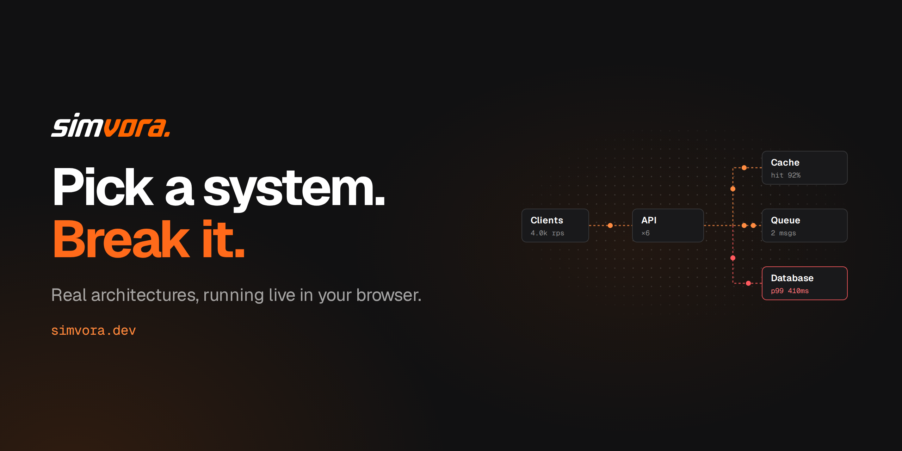
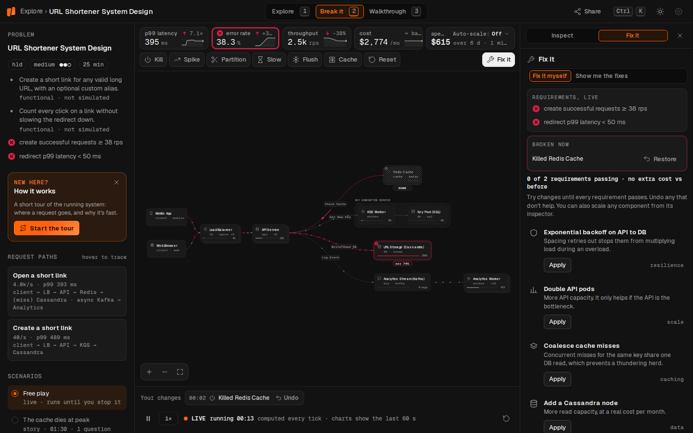

<p align="center">
  
</p>
<p align="center">
  <picture>
    <source media="(prefers-color-scheme: dark)" srcset="docs/assets/wordmark-dark.png">
    
  </picture>
</p>

<h3 align="center">You broke it. Now tell us about it.</h3>

<p align="center">
  The public issue tracker for <a href="https://simvora.dev"><b>simvora.dev</b></a>: bugs, wrong numbers, missing systems and big ideas.
</p>

<p align="center">
  <a href="https://github.com/simvora/simvora-issues/issues"></a>
  <a href="https://github.com/simvora/simvora-issues/issues?q=is%3Aissue+is%3Aopen+label%3Abug"></a>
  <a href="https://github.com/simvora/simvora-issues/issues?q=is%3Aissue+is%3Aopen+label%3Acontent-request+sort%3Areactions-%2B1-desc"></a>
  <a href="https://github.com/simvora/simvora-issues/issues?q=is%3Aissue+is%3Aclosed"></a>
</p>

<p align="center">
  <a href="https://simvora.dev"></a>
</p>

---

## Simvora is meant to break. Not like that.

You're supposed to kill Redis and watch the URL shortener fall over. You're *not* supposed to find a timeline that won't
scrub, a p99 that makes no sense, or a passkey that won't stick.

When you find one of those, this is the place to tell us. Every report makes the systems more real for the next person
who breaks them.

## Pick what you found

<table>
  <tr>
    <td width="50%" valign="top">
      <h3>🐞 Something's broken</h3>
      A page won't load, the player freezes, particles stop moving, a button does nothing.
      <br><br>
      <a href="https://github.com/simvora/simvora-issues/issues/new?template=1-bug.yml"><b>Report a bug →</b></a>
    </td>
    <td width="50%" valign="top">
      <h3>📝 Something's wrong</h3>
      A latency that's off by 10×, a fix with the wrong trade-off, a quiz answer you can prove is wrong.
      <br><br>
      <a href="https://github.com/simvora/simvora-issues/issues/new?template=2-content-error.yml"><b>Report a content error →</b></a>
    </td>
  </tr>
  <tr>
    <td width="50%" valign="top">
      <h3>📐 Something's missing</h3>
      A system you want to take apart, a concept you want explained, an LLD or DSA problem to practise.
      <br><br>
      <a href="https://github.com/simvora/simvora-issues/issues/new?template=4-content-request.yml"><b>Request content →</b></a>
    </td>
    <td width="50%" valign="top">
      <h3>💡 Something could be better</h3>
      An idea for the player, the paths, the concepts library or anything else on the site.
      <br><br>
      <a href="https://github.com/simvora/simvora-issues/issues/new?template=5-feature.yml"><b>Suggest a feature →</b></a>
    </td>
  </tr>
  <tr>
    <td width="50%" valign="top">
      <h3>🔑 Your account is acting up</h3>
      Can't sign in, a passkey won't work, or your progress didn't save or sync.
      <br><br>
      <a href="https://github.com/simvora/simvora-issues/issues/new?template=3-account.yml"><b>Get account help →</b></a>
    </td>
    <td width="50%" valign="top">
      <h3>🔒 You found a security hole</h3>
      Please don't post it here. Email us privately and we'll get back to you within 3 working days.
      <br><br>
      <a href="mailto:support@simvora.dev"><b>support@simvora.dev →</b></a> · <a href="./SECURITY.md">policy</a>
    </td>
  </tr>
</table>

## Want it fixed fast? Send the moment

<p align="center"></p>

The **Share** button at the top of every system gives you a link that opens the diagram at the exact second, and in
the exact state, you're looking at. Paste it into your issue and we see what you saw, with nothing lost in translation.

A few more things that help:

- 🔍 **Search first.** If it's already reported, add a 👍 instead of a comment. We sort by reactions, so a 👍 is a vote.
- ☝️ **One problem per issue.** Two bugs in one issue means neither can be closed.
- 📚 **For wrong content, bring a source.** Docs, a paper, an engineering blog post, or your own production scars.
- 🙈 **Keep it private.** No email addresses, tokens or account screenshots. This repo is public.

## What happens next

```
  needs-triage  ──▶  confirmed  ──▶  planned  ──▶  fixed-on-site 🎉
       │
       └──▶  needs-info  ──▶  (no reply in 14 days)  ──▶  closed, reopen any time
```

| Label | What it means |
|---|---|
| `needs-triage` | New. Nobody has looked at it yet |
| `needs-info` | We asked you something. It goes back to triage as soon as you reply |
| `confirmed` | We can reproduce it, or we agree it's wrong |
| `planned` | We're going to do it |
| `fixed-on-site` | It's live on simvora.dev |
| `duplicate` · `wontfix` · `not-a-bug` | Closed, always with a reason |

### Critical issues come with a deadline

If the site is down or unusable, data is lost, or content is badly wrong for everyone, the issue gets
`priority: critical`, and that comes with two promises:

| | Deadline |
|---|---|
| ⏱️ Triaged | within **14 days** |
| ✅ Fixed and closed | within **45 days** |

A bot checks every day. If we miss either deadline, the issue is labelled `overdue: triage` or `overdue: fix` and
called out in the thread, in public, where it can't quietly slip.

For everything else, Simvora is built by a small team, so we won't promise a timeline. We do read everything, and wrong
content always jumps the queue.

## Be excellent to each other

Critique the work, not the person. See the [code of conduct](./CODE_OF_CONDUCT.md).

---

<p align="center">
  <a href="https://simvora.dev"><b>simvora.dev</b></a> · <a href="https://simvora.dev/explore">Explore systems</a> · <a href="https://simvora.dev/concepts">Concepts</a> · <a href="https://simvora.dev/paths">Learning paths</a> · <a href="mailto:support@simvora.dev">Contact</a>
</p>
<p align="center"><sub>Pick a system. Break it. Then tell us what broke.</sub></p>
